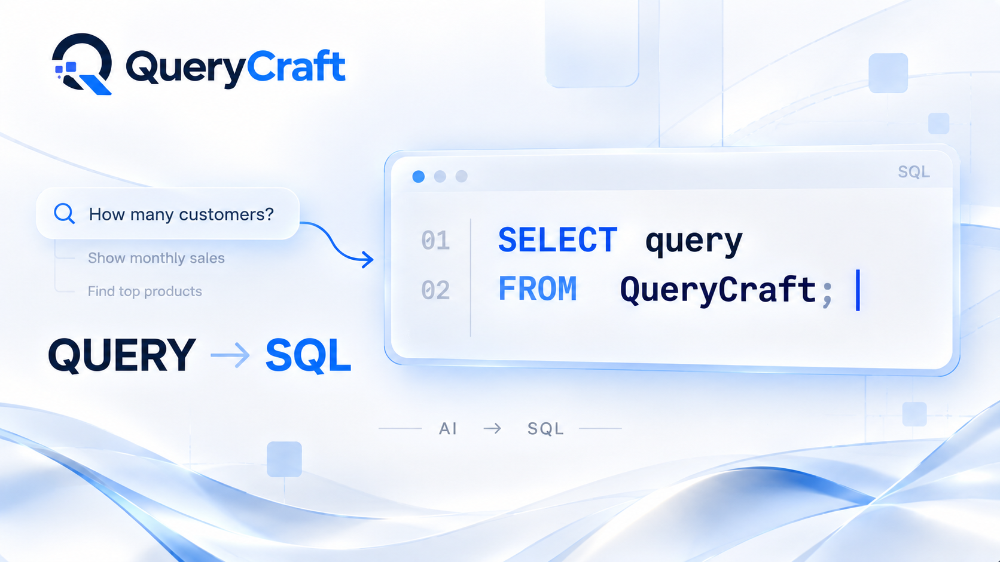

<h1>QueryCraft</h1>

    QueryCraft is an AI-powered MySQL SQL assistant that converts natural language
    questions into SQL queries and provides simple explanations of the generated queries.

    <strong>Developed by Shrinath Khot</strong>

    

<h2>About the Project</h2>

    QueryCraft helps users interact with structured data using natural language.
    Instead of manually writing SQL queries, users can ask questions about their
    data and QueryCraft generates the appropriate MySQL query.

For example, users can ask:

<ul>
    <li>Show the top 10 products by revenue.</li>
    <li>What is the total revenue by category?</li>
    <li>Which customers have placed the most orders?</li>
</ul>

    QueryCraft understands the database schema defined in its system prompt,
    generates a MySQL query, and provides a simple explanation of the query.

<h2>What QueryCraft Can Do</h2>

<ul>
    <li>Convert natural language questions into MySQL queries.</li>
    <li>Generate SQL queries using multiple related tables.</li>
    <li>Use JOIN operations based on defined table relationships.</li>
    <li>Generate aggregate queries using SUM, COUNT, AVG and other SQL functions.</li>
    <li>Perform revenue and profit analysis.</li>
    <li>Provide beginner-friendly SQL explanations.</li>
    <li>Follow a predefined database schema.</li>
    <li>Restrict SQL generation to the tables and columns defined in the system prompt.</li>
</ul>

<h2>How It Works</h2>

<ol>
    <li>The user enters a natural language question.</li>
    <li>The frontend sends the question to the Flask backend.</li>
    <li>The backend passes the question to the LangChain prompt template.</li>
    <li>The system prompt provides the database schema and SQL generation rules.</li>
    <li>OpenRouter sends the request to the selected AI model.</li>
    <li>The AI generates a MySQL query and a simple explanation.</li>
    <li>The response is returned to the Flask application.</li>
    <li>The frontend displays the generated query and explanation.</li>
</ol>

<h2>Technologies Used</h2>

<ul>
    <li><strong>Python</strong> - Backend programming language</li>
    <li><strong>Flask</strong> - Web application backend</li>
    <li><strong>LangChain</strong> - LLM application framework</li>
    <li><strong>ChatPromptTemplate</strong> - Structured prompt creation</li>
    <li><strong>OpenRouter</strong> - AI model API provider</li>
    <li><strong>Gemma 4 31B IT</strong> - AI model used by QueryCraft</li>
    <li><strong>HTML</strong> - Frontend structure</li>
    <li><strong>CSS</strong> - Frontend styling</li>
    <li><strong>JavaScript</strong> - Frontend interaction and API communication</li>
    <li><strong>python-dotenv</strong> - Environment variable management</li>
    <li><strong>Docker</strong> - Application containerization</li>
</ul>

<h2>AI Model</h2>

    QueryCraft uses OpenRouter as the AI API provider.

    <strong>AI Provider:</strong> OpenRouter

    <strong>Model:</strong> gemma-4-31b-it

    The model is connected to the application using LangChain's
    <strong>ChatOpenRouter</strong> integration.

<h2>Database Tables</h2>

    QueryCraft currently works with the following five MySQL tables:

<ol>
    <li><strong>customers</strong></li>
    <li><strong>orders</strong></li>
    <li><strong>order_items</strong></li>
    <li><strong>products</strong></li>
    <li><strong>regions</strong></li>
</ol>

    The complete database schema is defined inside the system prompt in
    <strong>app.py</strong>.

    The system prompt contains the table columns, data types, relationships,
    JOIN conditions, business metrics, and SQL generation rules.

<h2>Table Relationships</h2>

    The relationships between the five tables are defined in the system prompt
    inside <strong>app.py</strong>.

    QueryCraft uses these relationships when generating SQL JOIN queries.

    If you change the database, update the table relationships and JOIN conditions
    inside the system prompt.

<h2>Prompt Engineering</h2>

    QueryCraft uses a structured system prompt to control how the AI generates SQL.

The system prompt defines:

<ul>
    <li>Database type</li>
    <li>Available tables</li>
    <li>Available columns</li>
    <li>Table relationships</li>
    <li>JOIN conditions</li>
    <li>SQL generation rules</li>
    <li>Business metrics</li>
    <li>Required response format</li>
</ul>

    QueryCraft uses <strong>ChatPromptTemplate</strong> from LangChain to combine
    the system instructions with the user's question before sending the request
    to the AI model.

<h2>Changing the Database</h2>

    QueryCraft can be adapted to work with a different dataset or database schema.

    To use another database, update the system prompt in
    <strong>app.py</strong>.

Update the following information:

<ul>
    <li>Database name</li>
    <li>Table names</li>
    <li>Column names</li>
    <li>Column data types</li>
    <li>Table relationships</li>
    <li>JOIN conditions</li>
    <li>Business metrics</li>
    <li>SQL generation rules</li>
    <li>Response format</li>
</ul>

    The AI should only generate SQL using tables and columns that actually exist
    in the configured database.

<h2>Getting Your Own OpenRouter API Key</h2>

    QueryCraft requires an OpenRouter API key to communicate with the AI model.

<ol>
    <li>Create an account on OpenRouter.</li>
    <li>Open the API Keys section.</li>
    <li>Create a new API key.</li>
    <li>Copy your API key.</li>
    <li>Store the key inside your local <strong>.env</strong> file.</li>
</ol>

    Do not place your API key directly inside your Python, JavaScript, HTML,
    or Dockerfile.

<h2>Environment Variables</h2>

    Create a file named:

<pre>.env</pre>

    Add your OpenRouter API key:

<pre>OPENROUTER_API_KEY="your api key"</pre>

    Replace <strong>your api key</strong> with your actual OpenRouter API key.

    QueryCraft uses <strong>python-dotenv</strong> to load the environment variable.

<h2>Installation</h2>

    Open a terminal inside the QueryCraft project folder.

<pre>cd "Query Craft"</pre>

    Install the required dependencies:

<pre>pip install -r requirements.txt</pre>

    If you are using uv:

<pre>uv pip install -r requirements.txt</pre>

<h2>Run Locally</h2>

    Make sure your <strong>.env</strong> file contains your OpenRouter API key.

    Run the application:

<pre>python app.py</pre>

    Open the application in your browser:

<pre>http://127.0.0.1:5000</pre>

<h2>Docker</h2>

    QueryCraft can also be run using Docker.

<h3>Build the Docker Image</h3>

<pre>docker build -t querycraft .</pre>

<h3>Run the Container</h3>

<pre>docker run --env-file .env -p 5000:5000 querycraft</pre>

    After starting the container, open:

<pre>http://localhost:5000</pre>

<h3>Docker Hub</h3>

    QueryCraft is available as a Docker image on Docker Hub.

    <strong>Docker Hub:</strong>
    <a href="https://hub.docker.com/r/shrinathkhot/querycraft">
        View QueryCraft Docker Image
    </a>

    Pull the Docker image:

<pre>docker pull shrinathkhot/querycraft:latest</pre>

    Run the Docker image:

<pre>docker run --env-file .env -p 5000:5000 shrinathkhot/querycraft:latest</pre>

<h2>Project Structure</h2>

<pre>
Query Craft/
│
├── app.py
├── ChatBOT.py
├── requirements.txt
├── .env
├── Dockerfile
├── .dockerignore
├── QueryCraft_Thumbnail.png
│
├── demo/
│   └── QueryCraft_Demo.mp4
│
├── templates/
│   └── index.html
│
└── static/
    ├── style.css
    ├── script.js
    ├── bg.png
    └── logo.png
</pre>

<h2>Example Queries</h2>

<h3>Easy</h3>

<pre>Show the top 10 products by revenue.</pre>

<h3>Intermediate</h3>

<pre>What is the total revenue and profit for each product category?</pre>

<h3>Advanced</h3>

<pre>
Find the top 5 customers by total revenue,
along with their order count, total quantity purchased, and profit.
</pre>

<h2>Security</h2>

<ul>
    <li>Never share your OpenRouter API key.</li>
    <li>Never commit the <strong>.env</strong> file to GitHub.</li>
    <li>Add <strong>.env</strong> to <strong>.gitignore</strong>.</li>
    <li>Use environment variables for API credentials.</li>
    <li>Do not hardcode API keys inside the application.</li>
</ul>

<h2>Demo</h2>

    A demo recording of QueryCraft is included in the project.

    <strong>Demo:</strong> demo/QueryCraft_Demo.mp4

<h2>Purpose of the Project</h2>

    QueryCraft was created to demonstrate how Generative AI and Large Language
    Models can be used to build a natural language interface for SQL generation
    and SQL learning.

    The project combines Prompt Engineering, LangChain, OpenRouter, Flask,
    frontend development, MySQL, Docker, and Generative AI into a single
    AI-powered SQL application.

<h2>Key Concepts Used</h2>

<ul>
    <li>Generative AI</li>
    <li>Large Language Models</li>
    <li>Prompt Engineering</li>
    <li>System Prompts</li>
    <li>LangChain</li>
    <li>ChatPromptTemplate</li>
    <li>OpenRouter API</li>
    <li>Natural Language to SQL</li>
    <li>MySQL</li>
    <li>Flask</li>
    <li>REST API</li>
    <li>HTML</li>
    <li>CSS</li>
    <li>JavaScript</li>
    <li>Docker</li>
    <li>Environment Variables</li>
</ul>

<h2>Important Note</h2>

    QueryCraft generates SQL based on the database schema and rules provided
    in its system prompt.

    The complete schema information, including tables, columns, relationships,
    JOIN conditions, business metrics, and SQL generation rules, is maintained
    in the system prompt inside <strong>app.py</strong>.

    If you use a different dataset, update the system prompt with the correct
    database structure and business rules.

    The quality of generated SQL depends on the accuracy and completeness of
    the schema and instructions provided to the model.

<h2>Author</h2>

    <strong>Shrinath Khot</strong>

    B.Tech Computer Engineering

    Built with Python, Flask, LangChain, OpenRouter and Generative AI.

    <strong>QueryCraft — SQL, Made Simple.</strong>

